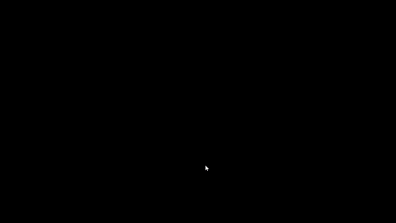

# Bouncers
An exercise to learn about functions and classes.

Please find instructions in [instructions.md](instructions.md).

Controls: 
X = spawn bouncers(last a limited time)

The gif above displays a short little demo of my game called bouncers, the name describes the game for the main part. With X you can spawn bouncers which will then spawn in for a small amount of time before disspearing, these bouncers will go around the map either up or down and bounce off of the walls when they come into contact with them. They all go random directions and random speeds making it different just about each time.

https://github.com/rrmez2005-pixel/bouncers